## 一句话总结

软件构造是通过编码、验证、单元测试、集成测试和调试的结合，生产可工作的、有意义的软件的详细创建过程——它是**设计的延续**（源程序是设计的最后一个规划，编译才是真正的"实现"），核心活动包括详细设计、编程、测试、调试、代码评审、集成构建和构造管理，由重构、TDD 和结对编程三大实践方法支撑。

## 知识地图

```mermaid
flowchart TD
    CONSTRUCT[软件构造 Construction] --> DEF[定义: SWEBOK + McConnell]
    CONSTRUCT --> INSIGHT[核心洞察: 源程序是设计, 编译才是实现 Reeves 1992]

    CONSTRUCT --> ACTIVITIES[构造活动]
    ACTIVITIES --> DESIGN[详细设计: 更小规模的延续]
    ACTIVITIES --> CODING[编程: 易读/易维护/可靠/性能/安全]
    ACTIVITIES --> TEST[测试: 单元测试 + 集成测试]
    ACTIVITIES --> DEBUG[调试: 重现→诊断→修复]
    ACTIVITIES --> REVIEW[代码评审: 正式/轻量级/结对编程]
    ACTIVITIES --> INTEG[集成与构建: 增量式 > 大爆炸式]
    ACTIVITIES --> MGMT[构造管理: 计划/度量/配置管理]

    CONSTRUCT --> PRACTICES[实践方法]
    PRACTICES --> REFACTOR[重构: 不改变外部行为, 改进内部结构]
    PRACTICES --> TDD[测试驱动开发: Red→Green→Refactor]
    PRACTICES --> PAIR[结对编程: Driver + Observer]

    CONSTRUCT --> IDEAS[Construction Ideas]
    IDEAS --> ADVANCES[10大进展: 抽象层次提升→LLM辅助]
    IDEAS --> REALITIES[10个现实: 个体差异/纪律/简单性/增量]
    IDEAS --> WORST[最坏想法: 全预先设计 vs 全不设计]
```

## 核心概念

### 1. 软件构造的定义与定位

**SWEBOK 2004 定义**：软件构造是通过编码、验证、单元测试、集成测试和调试等工作的结合，生产可工作的、有意义的软件的详细创建过程。

**McConnell 2004**：除了核心编程任务，还涉及详细设计（数据结构与算法设计）、单元测试、集成与集成测试等活动。

**Reeves 1992 的核心洞察**：
- 设计是规划软件构建方案的过程，实现是依据规划建造真正产品的过程
- **源程序是软件构建方案的最后一个规划，不是产品本身**——真正的产品是运行于计算机上的可执行程序
- 源程序的编写（编程）属于**设计活动**；编译器完成的编译和链接才是依据规划建造软件产品的**实现活动**
- 启示：仔细区分设计与实现的界限——编程本质上是设计工作

### 2. 软件构造活动

软件构造包含七项核心活动：

**① 详细设计**：软件构造阶段的详细设计与软件设计阶段使用相同的方法和技术，但应用在更小的规模上。编码过程中不可避免会调整详细设计——因为编程语言是设计的重要约束，随编码深入会发现与预想不一致的情况。

**② 编程**：程序代码的典型质量目标——**易读性**（看上去"显而易见是正确的"，是编程最重要的目标）> 易维护性 > 可靠性 > 性能 > 安全性。主要技术涵盖：命名和空间布局、类/枚举/变量/常量的使用、控制结构、错误处理、安全漏洞预防、资源管理（互斥/锁）、源代码组织、代码文档、代码调整。

**③ 测试**：每次修改程序后进行最少一次单元测试。单元测试证实程序达到要求且无错误；集成测试在单元测试之后，测试多单元间接口是否正确。测试关心的是**建立缺陷的存在性**（establishing the existence of defects）。

**④ 调试**：调试关心的是**定位和修复错误**（locating and repairing errors），分为三个阶段：
- **重现问题**：控制输入（回溯推理/内存监控/日志）；控制环境（替换机器/OS/DBMS——如果确信代码无缺陷，警惕软件环境问题）
- **诊断缺陷**：编译器提示 → 持续缩小嫌疑范围 → 检查刚修改部分 → 警惕常见缺陷 → 利用工具
- **修复缺陷**：一次只修一个 → 保留旧版本备份 → 测试验证修复 → 检查类似缺陷

**LLM 辅助调试**：粘贴编译错误/堆栈跟踪直接定位根因；描述 Bug 现象让大模型推断可能代码路径；追问"代码库中还有哪些类似写法可能存在同样问题"。

**⑤ 代码评审**：对代码的系统检查，通常通过同行专家评审完成。三种形式：正式评审、轻量级评审、结对编程。

实践经验：至少评审 20-33% 代码；一次评审 < 200-400 行；速率 < 300-500 LOC/h；每次 ≤ 60-90 分钟；使用检查列表；确认缺陷被修复；培养积极的评审文化。

**LLM 辅助代码评审**：自动检测坏味道（命名不规范/过长方法/魔法数字/重复代码）；安全审查（缓冲区溢出/SQL 注入/资源泄漏）；风格一致性（Google Style/阿里规约）。工作流：① PR 前 LLM 预审 → ② 人工聚焦架构/业务逻辑 → ③ LLM 生成检查列表。

**⑥ 集成与构建**：将分散的例程/类集成为构件、子系统和完整系统。**增量式集成效果远优于大爆炸式集成**。构建将源代码转为可执行文件，需配置管理工具辅助。

**⑦ 构造管理**：构造计划（定义构建次序、选方法、分配任务）、度量（复杂度/代码行/注释）、配置管理（开发库使用规则、代码提交）。

### 3. 实践方法

#### 重构（Refactoring）

**定义**：修改软件系统的严谨方法，在不改变代码外部表现的情况下改进其内部结构。

**重构时机**：
- 增加新功能**之后**（消除新代码引入的坏味道）——不是增加功能之前
- 发现并修复缺陷时
- 进行代码评审时

**代码坏味道**（Code Smells）：
| 坏味道 | 含义 |
|--------|------|
| 太长的方法 | 非功能内聚，超过一屏幕需留心 |
| 太大的类 | 非单一职责，需分解 |
| 太多的方法参数 | 任务太多或抽象层次太低 |
| 多处相似的控制结构 | 多态策略不足，用继承树多态消除 |
| 重复的代码 | 隐式耦合，提取为独立方法 |
| 过多使用其他类的属性 | 属性分配或协作设计不正确 |
| 过多的注释 | 代码逻辑结构不清晰或可读性不好 |

#### 测试驱动开发（TDD）

**定义**：在编写一段代码之前，先完成该段代码的测试代码。又称测试优先（Test First）开发。

**TDD 循环**：Red（写失败测试）→ Green（写代码使测试通过）→ Refactor（重构改进结构）。

**AI-TDD**：传统 TDD 的手写测试 → LLM 生成测试；LLM 在 Red 阶段生成全面的失败测试（等价类+边界值），Green 阶段生成最简实现，Refactor 阶段识别坏味道并建议重构方案。

#### 结对编程（Pair Programming）

**定义**：两个程序员并肩工作，协作完成同一设计/算法/代码/测试。

**角色**：
- **Driver（驱动者）**：控制键盘/鼠标，主动实现程序
- **Observer（观察者）**：持续观察，识别战术性缺陷（语法/拼写），同时战略性思考工作方向

**工作机制**：
- **Pair-Pressure**：互相保持专注
- **Pair-Think**：带入不同的先前经验
- **Pair-Relaying**：轮流贡献最佳能力，一人"战斗"时另一人思考
- **Pair-Reviews**：持续的设计和代码评审——缺陷预防永远比缺陷移除更高效（80% 的独立程序员不经常做评审）
- **Pair-Debugging**：结对讨论问题往往能让解决方案变得显而易见
- **Pair-Learning**：持续评审 → 互相学习技术/语言/领域知识

**LLM 作为虚拟结对伙伴**：开发者 Driver + LLM Observer（持续审查语法/逻辑/设计）；或 LLM Driver + 开发者 Observer（LLM 生成初版代码，开发者审查调整）。优势：随时可用、无疲劳、知识面广泛。局限：缺乏真实业务理解、无法感知团队规范隐性知识。

### 4. Construction Ideas

**软件构造的十大进展**（A Decade of Advances）：
1. **设计层次提升**：从语句→例程→类→包，OO 的真正遗产是更大的代码聚合
2. **每日构建与冒烟测试**：制度化增量集成，最小化严重集成问题
3. **标准库**：Java/C++/.NET 自带的标准库
4. **可视化编程**：VB 首创广泛使用 COTS 组件的开发环境
5. **开源软件**：开发中的巨大助力，降低代码获取壁垒
6. **Web 研究资源**：FAQ、讨论组、可搜索性
7. **增量开发广泛使用**：概念在 1990s 已知，实践在 2000s 确立
8. **测试优先开发**：缩短缺陷检测时间，增加个人纪律
9. **重构成为独立学科**：提供修改的纪律，增量主义的典范
10. **更快的计算机**：影响优化策略、编程语言选择、开发方式
11. **（新增）LLM 辅助编程**：2020s 继 OO/重构/TDD 之后的新范式转变

**现代软件构造的十大现实**：
- 个体差异显著（编码/调试/找缺陷速度差异 10x-28x）
- 个人纪律重要（重构/原型/优化/最小复杂度设计等方面）
- 关注简单性比关注复杂性更有效（关注读时代价，而非写时代价）
- 缺陷成本随阶段递增——越晚发现代价越大
- 极端通常不高效（全预先设计 vs 全不设计、全计划 vs 全即兴）
- 技术浪潮影响构造实践
- **增量方法效果最好**——纯瀑布模型不增量不迭代，导致效果差
- 工具箱隐喻具有启发意义——没有一种工具适合所有工作
- 软件的根本张力恒久不变：刚性计划 vs 即兴、创造力 vs 结构、纪律 vs 灵活

**1990s/2000s 最坏构造想法**：
| 1990s | 2000s |
|-------|-------|
| "全预先设计" | "全不预先设计" |
| 为推测性需求设计 | 计划"以后重构" |
| 组件能解决所有构造问题 | 离岸外包能解决所有问题 |
| 自动编程 | 自动编程 |
| 盲目使用瀑布模型 | 盲目使用极限编程 |
| 称一切为"面向对象" | 称一切为"敏捷" |

## 难点突破

### 难点 1：Reeves 的"编程即设计"论断

这可能是软件构造中最反直觉的洞察。日常直觉："我写代码 = 我在实现软件"。

**Reeves 的论证**：
- 设计的产物 = 规划/方案（蓝图）；实现的产物 = 真正的产品
- 源程序是**文本方案**——它描述软件应该怎样运行，但本身不能运行
- 编译器将源程序转化为可执行程序，才是真正的"制造"过程（类似工厂按图纸制造产品）
- 因此，**编程 = 设计活动，编译 = 实现活动**

**为什么重要**：这个视角转换解释了为什么编程质量如此重要——如果编程是设计，那么糟糕的代码就是糟糕的设计，而不是"实现细节可以后面再修"。

### 难点 2：TDD 的 Red→Green→Refactor 循环的严格顺序

很多初学者容易搞混：先写测试还是先写代码？为什么要先写**失败**的测试？

**正确顺序与原因**：
1. **Red（写失败测试）**——先定义"什么算成功"。测试失败证明测试本身是有效的（能检测到功能缺失）
2. **Green（写最简实现）**——只写刚好让测试通过的代码，不过度设计
3. **Refactor（重构）**——在安全网（测试全部通过）的保护下改进代码结构

如果先写代码再补测试，你写的测试可能只是"验证代码做了什么"而非"验证代码应该做什么"——失去了测试作为规格的作用。

## 与前章关联

本章是软件工程"构造"主题的核心，围绕它组织了多个补充材料：
- **04-01 详细设计**：讲了设计的基本概念 → 本章在更小规模上延续设计，实际编码中持续调整
- **补充-代码设计**：编程的技术细节（命名/格式/注释/控制结构）→ 本章是这些技术的上层框架和组织
- **补充-设计模式**：策略/工厂/单件/迭代器 → 本章的重构环节常引入设计模式消除坏味道

## 记忆卡片

**Q1：软件构造包含哪七项核心活动？**\
A：① 详细设计（更小规模的延续）；② 编程（易读 > 易维护 > 可靠 > 性能 > 安全）；③ 测试（单元测试 + 集成测试）；④ 调试（重现→诊断→修复）；⑤ 代码评审（正式/轻量级/结对编程）；⑥ 集成与构建（增量式 > 大爆炸式）；⑦ 构造管理（计划/度量/配置管理）。

**Q2：Reeves (1992) 关于"设计 vs 实现"的核心论断是什么？**\
A：源程序是软件构建方案的**最后一个规划**，不是产品本身。编程属于**设计活动**，编译器完成的编译和链接才是依据规划建造软件产品的**实现活动**。真正的产品是运行于计算机上的可执行程序。

**Q3：重构（Refactoring）的定义和三个触发时机？**\
A：**定义**：在不改变代码外部表现的情况下改进其内部结构的严谨方法。**时机**：① 增加新功能**之后**（消除新代码坏味道）；② 发现缺陷进行修复时；③ 代码评审发现坏味道时。重构不用于实现新功能。

**Q4：TDD 的 Red→Green→Refactor 循环各阶段做什么？为什么必须先写失败测试？**\
A：**Red**：先写测试（失败证明功能缺失且测试有效）；**Green**：写最简实现让测试通过（不过度设计）；**Refactor**：在测试安全网保护下重构改进结构。先写测试确保测试验证的是"代码应该做什么"而非"代码做了什么"。

**Q5：结对编程中 Driver 和 Observer 各负责什么？LLM 如何扮演虚拟结对伙伴？**\
A：**Driver**：控制键盘/鼠标，主动实现；**Observer**：持续观察识别战术缺陷，战略性思考方向。**LLM 作为 Observer**：持续审查代码语法/逻辑/设计；**LLM 作为 Driver**：生成初版代码，开发者审查调整。优势：随时可用/无疲劳/知识面广；局限：缺业务理解/无法感知团队隐性知识。
