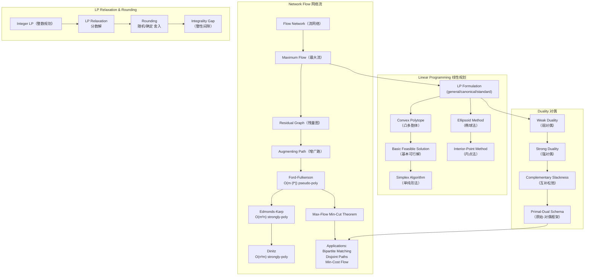

## 一句话总结

Network Flow 是离散优化问题——在有容量限制的有向图中最大化源到汇的流量，核心方法是 residual graph 上的 augmenting path；Linear Programming 将其推广为通用框架——在线性约束下优化线性目标，Duality 提供上下界，LP Relaxation & Rounding 将 NP-hard 问题转化为可近似的多项式时间问题。

## 知识地图



## 核心概念

### 1. Flow Network & Maximum Flow（流网络与最大流）

流网络是一个有向图 $G = (V, E)$，每条边 $e \in E$ 有容量 $c_e \in \mathbb{R}^+$。有一个源点 source $s \in V$ 和一个汇点 sink $t \in V$。

**Flow function** $f: E \to \mathbb{R}^+$ 必须满足：
- **容量约束**：$\forall e \in E, 0 \le f(e) \le c_e$
- **流守恒**（flow conservation）：$\forall v \in V \setminus \{s, t\}, \sum_{e \in \delta_{in}(v)} f(e) = \sum_{e \in \delta_{out}(v)} f(e)$

**Maximum flow problem**：找一个 valid flow $f$ 最大化 $|f| = \sum_{e \in \delta_{out}(s)} f(e)$，即从源点流出的总流量。

> 直观理解：把边想象成水管，容量是水管的粗细，流是实际通过的水量。每个中间节点不存储水——流进多少就流出多少。目标是从水源 $s$ 往水槽 $t$ 输送尽可能多的水。

### 2. Flow Decomposition & Residual Graph（流分解与残量图）

**Flow Decomposition Theorem**：任何一个 s-t flow 都可以分解为 s-t paths 和 cycles 的集合。构造性证明：当 $s$ 有 outflow 时，找一个 s-t path 并减去其 bottleneck flow；当没有 s-t path 但仍有 flow 时，剩余的 flow 一定形成 cycle。

贪心增广的问题：如果盲目增广一条路径，可能"挡住"更好的路径。

**Residual graph（残量图）** $G_f = (V, E')$ 是核心创新——它允许"撤销"流：
- **Forth edges**：对每条 $e = (u, v) \in E$ 且有剩余容量的（$c_e > f_e$），在 $G_f$ 中加入 $(u, v)$，容量为 $c_e - f_e$（还能增多少）
- **Back edges**：对每条 $e = (u, v) \in E$ 且有流的（$f_e > 0$），在 $G_f$ 中加入 $(v, u)$，容量为 $f_e$（能退多少）

> 反向边的直觉：如果在原图中往 $(u,v)$ 推了流，但在残量图中走 $(v,u)$ 方向，相当于"撤回部分流量"，让流走另一条路线。这就是 Ford-Fulkerson 能避开贪心陷阱的关键。

### 3. Augmenting Path Algorithms（增广路算法族）

所有增广路算法共享同一个框架：在残量图 $G_f$ 中找一条 s-t path $P$，然后沿 $P$ 增广 bottleneck 流量。

| 算法 | 选路策略 | 时间复杂度 | 类型 |
|------|----------|-----------|------|
| **Ford-Fulkerson** | 任意 path | $O(m \cdot |f^*|)$ | pseudo-polynomial（依赖容量值） |
| **Scaling (Capacity Scaling)** | fattest path（容量最大） | $O(m^2 \log C)$ | weakly-polynomial（依赖 log C） |
| **Edmonds-Karp** | shortest path（BFS） | $O(m^2 n)$ | strongly-polynomial（只依赖 m,n） |
| **Dinitz (Dinic)** | 分层 + 一轮增广所有最短路径 | $O(n^2 m)$ | strongly-polynomial |

**算法选择的直觉**：
- Ford-Fulkerson 每次增广可能只增 1 单位，在大容量上极慢。
- Scaling 优先跑"粗管子"：用 $2^i$ 阈值过滤残量图，每轮保证增广 $\ge 2^i$，共 $O(m \log C)$ 轮。
- Edmonds-Karp 始终走最短路径：每次增广后最短路径长度不降，最多 $n$ 个不同的路径长度，每个长度最多增广 $m$ 次。
- Dinitz 更进一步：用分层图一次性增广所有同层的最短路径（DFS on forth edges only），避免重复 BFS。

### 4. Max-Flow Min-Cut Theorem（最大流最小割定理）

定义一个 **s-t cut** $(S, \bar{S})$ 为将 $V$ 分成 $s \in S$ 和 $t \in \bar{S}$ 的划分，cut capacity 为：

$$\text{Cut}(S) = \sum_{(a,b) \in E, a \in S, b \notin S} c_{a,b}$$

**定理**：以下三个命题等价：
1. $f$ 是最大流（maximum flow）
2. 残量图 $G_f$ 中不存在 s-t path 且 $\delta(P) > 0$
3. 存在 cut $(S, \bar{S})$ 使得 $\text{Cut}(S) = |f|$

证明思路：
- $(1) \implies (2)$：反证法——如有 path 就能增广，$f$ 不是最大。
- $(2) \implies (3)$：令 $S$ 为 $G_f$ 中从 $s$ 可达的顶点集。所有从 $S$ 到 $\bar{S}$ 的原边必饱和（$f_e = c_e$），所有从 $\bar{S}$ 到 $S$ 的原边必为零（$f_e = 0$）。由流守恒可推 $|f| = \text{Cut}(S)$。
- $(3) \implies (1)$：任何流的量不超过任何割的容量，达到即最优。

> 这条定理提供了最大流的**最优性证书（certificate）**：找到一个满容量的割就证明了流是最优的。

### 5. Applications of Max Flow（最大流的应用）

**Maximum Bipartite Matching（二分图最大匹配）**：
- 构造流网络：$s$ 连所有左部顶点（容量 1），左部连右部（按原边，容量 1），右部连 $t$（容量 1）
- 最大流的值 = 最大匹配的大小（一一对应）

**Edge-Disjoint Paths（边不相交路径）**：
- 所有边容量设为 1，最大流 = 最多边不相交 s-t 路径数

**Minimum-Cost Flow Problem (MCFP)**：
- 每条边不仅有容量 $c_e$，还有成本 $a_e$
- 目标：在最大化流量的前提下最小化总成本 $\sum a_e \cdot f(e)$
- **Cycle Canceling 算法**：从任意最大流出发，只要残量图中有负环（negative cycle），沿环重定向流降低成本
- 最终状态：残量图无负环 $\iff$ 当前流是 min-cost max-flow

### 6. Linear Programming Formulation（线性规划形式化）

**General Form（一般形式）**：
$$\min c^T x \quad \text{s.t.} \quad \begin{cases} a_i^T x = b_i & i \in M \\ a_i^T x \ge b_i & i \notin M \\ x_j \ge 0 & j \in N \\ x_j \text{ unconstrained} & j \notin N \end{cases}$$

三种标准形式的转化：
- **Canonical form**（规范形）：$\min c^T x, \text{s.t. } Ax \ge b, x \ge 0$。等式变为两个不等式，无约束变量 $x_j = x_j^+ - x_j^-$ 拆分。
- **Standard form**（标准形）：$\min c^T x, \text{s.t. } Ax = b, x \ge 0$。$\le$ 约束加 slack variable，$\ge$ 约束减 surplus variable。
- **Max-Flow 作为 LP**：每条边变量 $f_{uv}$，约束为容量 $0 \le f_{uv} \le c_{uv}$ 和流守恒 $\sum_w f_{wu} - \sum_v f_{uv} = 0$（中间节点）。目标为 max $\sum_v f_{sv}$。

### 7. Geometry of LP（LP 的几何直觉）

- **Halfspace（半空间）**：$\{x \mid a^T x \ge b\}$，超平面的一侧
- **Convex polyhedron（凸多面体）**：有限个半空间的交集 $\{x \mid Ax \ge b\}$
- **Convex polytope（凸多胞体）**：有界的 convex polyhedron
- **Vertex / Extreme point**：不能表示为 polyhedron 中其他两点的凸组合的点

**关键命题**：
- 凸多面体有 vertex $\iff$ 它不包含一条直线（no line）
- Vertex = Extreme point
- **若 LP 有最优解且多面体有 vertex，则存在一个最优解恰在 vertex 上**

这解释了为什么 Simplex 只需在顶点间移动：最优解一定在某个顶点。

### 8. Simplex Algorithm & LP Solvers（单纯形法与 LP 求解器）

**Basic Feasible Solution (bfs)**：在标准形 $Ax = b, x \ge 0$ 中，选 $m$ 个线性无关列构成 basis $B$，令 $x_B = A_{[m]\times B}^{-1} b$，其余变量为 0。若 $x_B \ge 0$ 则是 bfs。**bfs = vertex**。

**Simplex Algorithm (Dantzig 1947)**：
- 从任意 bfs 出发
- 检查邻居 bfs（共享 $m-1$ 个 basis 列）：若存在目标函数更小的邻居，移动过去
- 局部最优 = 全局最优（convexity 保证）
- **最坏情况指数时间**（Klee-Minty cube, 1972），但实践中很快
- **Smoothed complexity 为多项式** [Spielman-Teng '01]

**多项式时间求解器**：
| 方法 | 时间 | 思路 |
|------|------|------|
| Ellipsoid Method (Khachiyan '79) | $O(n^6)$ | 维护包含可行域的椭球，不断切半 |
| Interior-Point Method (Karmarkar '84) | $O(n^{2.5})$ [Vaidya '89] | 保持在多面体内部，用罚函数远离边界 |

### 9. LP Relaxation & Rounding（LP 松弛与舍入）

当问题是 NP-hard 的整数规划（ILP）时，标准套路分四步：

1. **Modeling**：将优化问题表达为 Integer Linear Program（变量 ∈ {0,1} 或 ℤ）
2. **Relaxation**：将整数约束放松为连续约束（$x \in [0,1]$ 而非 $\{0,1\}$）→ LP 可多项式求解
3. **Rounding**：将 LP 最优解 $x^*$ 舍入为合法的整数解 $\hat{x}$
4. **Analysis**：证明 $\hat{x}$ 离最优整数解不远（approximation ratio）

**Vertex Cover 案例**：
- ILP：$\min \sum_{v} x_v$ s.t. $\forall e, \sum_{v \in e} x_v \ge 1$，$x_v \in \{0,1\}$
- LP relaxation：$x_v \in [0,1]$
- Rounding：$\hat{x}_v = 1$ if $x_v^* \ge 0.5$，otherwise $0$
- 分析：$\hat{x}_v \le 2x_v^*$，所以 $\text{SOL} \le 2 \cdot \text{OPT}_{LP} \le 2 \cdot \text{OPT}_{ILP}$
- **2-approximation**，且 integrality gap = 2（[Singh '19]）

**MAX-SAT 案例**：
- ILP 表达：每个 clause $C_j$ 关联布尔变量 $x_i$，设 $y_j$ 表示 clause 是否被满足
- LP relaxation → linear randomized rounding：独立地令 $\hat{x}_i = 1$ 以概率 $x_i^*$
- 分析：$\Pr[C_j \text{ satisfied}] \ge (1 - 1/e) \cdot y_j^*$（利用 AM-GM + Jensen 不等式）
- 结合 random assignment + LP rounding 的 **Power of Two Choices**：取两者更好的解 → **3/4-approximation**
- 可用 non-linear rounding $f(x) = \frac{1}{2} + \frac{x}{4}$ 一步达成 3/4
- MAX-3SAT 有 7/8-approximation（SDP relaxation），且除非 P=NP 不能更好

### 10. Duality（对偶理论）

**LP Duality 的构造**：

| Primal (min) | Dual (max) |
|-------------|------------|
| $\min c^T x$ | $\max b^T y$ |
| s.t. $Ax \ge b$ | s.t. $y^T A \le c^T$ |
| $x \ge 0$ | $y \ge 0$ |

**经济解释（Surviving Problem）**：
- Primal：花最少的钱买食物，满足所有营养素最低需求
- Dual：设计药丸定价体系，与天然食物竞争，最大化总价

**Weak Duality Theorem**：对任意 feasible $x, y$，$y^T b \le c^T x$
- 证明：$y^T b \le y^T A x \le c^T x$

**Strong Duality Theorem**：primal 有有限最优解 $x^*$ $\iff$ dual 有有限最优解 $y^*$，且 $y^{*T} b = c^T x^*$

**Complementary Slackness（互补松弛）**：
$x$ 和 $y$ 都是最优的 $\iff$
- $\forall i$：要么 $A_{i\cdot}x = b_i$，要么 $y_i = 0$（primal 约束紧 or dual 变量零）
- $\forall j$：要么 $y^T A_{\cdot j} = c_j$，要么 $x_j = 0$（dual 约束紧 or primal 变量零）

> 直觉：最优时，资源和价格中至少有一个是"紧的"。如果某营养素摄入超标了（slack），那对应的药丸就不值钱（$y_i=0$）；如果某食物的价格高于药丸组合价，那就不吃它（$x_j=0$）。

### 11. Primal-Dual Schema（原始-对偶框架）

将 complementary slackness 放松为近似条件，得到一个强大的近似算法设计框架：

$$\forall i: \text{either } A_{i\cdot}x \le \alpha \cdot b_i \text{ or } y_i = 0$$
$$\forall j: \text{either } y^T A_{\cdot j} \ge c_j / \beta \text{ or } x_j = 0$$

满足上述 relaxed complementary slackness 的解满足 $c^T x \le \alpha\beta \cdot \text{OPT}$

**Vertex Cover 的 Primal-Dual 算法**（$\alpha = 2, \beta = 1$）：
1. 初始 $x = 0, y = 0$
2. 当存在未覆盖的边 $e$：提升 $y_e$ 直到某个顶点 $v$ 变"紧"（$\sum_{e \ni v} y_e = 1$）
3. 对所有紧顶点设 $x_v = 1$，删除其关联的所有边
4. 分析：这等价于找 maximal matching → 2-approximation

## 术语对照

| English | 中文 | 说明 |
|---------|------|------|
| Flow Network | 流网络 | 有容量限制的有向图，含 source 和 sink |
| Residual Graph | 残量图 | 包含 forth edges（剩余容量）和 back edges（可撤销流）的有向图 |
| Augmenting Path | 增广路 | 残量图中从 s 到 t 的一条路径 |
| Max-Flow Min-Cut Theorem | 最大流最小割定理 | 最大流的值等于最小割的容量 |
| Pseudo-polynomial | 伪多项式 | 时间复杂度依赖输入数值大小（如 $\vert f^*\vert$）而非仅输入规模 |
| Strongly-polynomial | 强多项式 | 时间复杂度仅依赖图的顶点数和边数（m, n） |
| Linear Programming (LP) | 线性规划 | 在线性约束下优化线性目标函数 |
| Convex Polyhedron | 凸多面体 | 有限个半空间的交集 |
| Basic Feasible Solution (bfs) | 基本可行解 | 对应标准形 LP 的顶点 |
| Simplex Algorithm | 单纯形法 | 在多胞体顶点间沿边移动的 LP 算法 |
| Ellipsoid Method | 椭球法 | 通过不断缩小包含可行域的椭球来求解 LP |
| Interior-Point Method | 内点法 | 保持在多面体内部，用罚函数逼近最优解 |
| LP Relaxation | LP 松弛 | 将整数约束放松为连续约束 |
| Integrality Gap | 整性间隙 | $\sup_I \text{OPT}(I)/\text{OPT}_{LP}(I)$，衡量 LP 松弛的质量 |
| Duality | 对偶 | Primal LP 和 Dual LP 的对称关系 |
| Complementary Slackness | 互补松弛 | 最优时 primal/dual 变量和约束的零-紧互补条件 |
| Primal-Dual Schema | 原始-对偶框架 | 同时构造 primal 整数解和 dual 分数解来获得近似比的通用方法 |

## 关键原句

> "Theorem: Any s-t flow can be decomposed into cycles and s-t paths."
> **翻译：** 任何 s-t 流都可以分解为若干环和 s-t 路径。

> "While exists s-t path P in G_f with δ(P) > 0: increase the flow f in P by δ(P)."
> **翻译：** 只要残量图 G_f 中存在 bottleneck 大于 0 的 s-t 路径 P，就沿 P 增加流 f，增量为 δ(P)。

> "The following statements are equivalent: (1) f is a maximum flow; (2) There is no s-t path P in G_f with δ(P) > 0; (3) There is S, ¬S ⊆ V such that Cut(S) = |f|."
> **翻译：** 以下命题等价：(1) f 是最大流；(2) 残量图中不存在 bottleneck > 0 的 s-t 路径；(3) 存在割 (S, ¬S) 使得割容量等于流值。

> "Naive Ford-Fulkerson algorithms takes time O(|f*| · m)."
> **翻译：** 朴素的 Ford-Fulkerson 算法时间复杂度为 O(|f*| · m)。

> "If the convex polyhedron {x ∈ ℝⁿ | Ax ≥ b} has a vertex and the LP min{cᵀx | Ax ≥ b} has an optimal solution, then there is an optimal solution that is a vertex."
> **翻译：** 如果凸多面体有顶点且 LP 有最优解，则存在一个最优解恰好在某个顶点上。

> "Weak Duality: ∀ feasible primal solution x and dual solution y: yᵀb ≤ cᵀx."
> **翻译：** 弱对偶：对任意可行的原始解 x 和对偶解 y，有 yᵀb ≤ cᵀx。

> "The integrality gap of the LP-relaxation for Max-SAT is 3/4."
> **翻译：** MAX-SAT 的 LP 松弛的整性间隙为 3/4。

> "Primal LP has finite optimal solution x* iff dual LP has finite optimal solution y*. y*ᵀb = cᵀx*."
> **翻译：** 原始 LP 有有限最优解 x* 当且仅当对偶 LP 有有限最优解 y*，且 y*ᵀb = cᵀx*。

## 难点突破

### 难点 1：残量图为什么同时需要 forth edge 和 back edge？

**卡住的点**：forth edge 很直观（还能推多少），但为什么要 back edge？流已经推过去了，为什么还能"撤销"？

**突破方法**——一个具体例子：
```
    s
   / \
  1   1
 /     \
a ----> b
   1
   t
```
所有边容量为 1。如果贪心先选 s→a→b→t，则 s→b→t 走不了（a→b 已满），总流 = 1。
但最优解是 2：s→a→t 和 s→b→t 各 1。

残量图的 back edge 解决了这个问题：推了 a→b 后，残量图中出现 b→a（容量 1）。于是在残量图中可以走 s→b→a→t！这意味着：把原来 a→b 的流改道——a 的来流走 a→t 而不是 a→b，b 的来流来自 s→b 而不是 a→b。

**一句话理解**：back edge 不是"撤销"，是"重定向"——允许之前的流改变目的地。

### 难点 2：LP Duality 的构造——如何从 Primal 写出 Dual？

**卡住的点**：为什么 min 变 max？为什么不等式方向反过来？为什么矩阵转置？

**机械转换法则**（canonical form: min cᵀx s.t. Ax ≥ b, x ≥ 0）：

| Primal (min) | Dual (max) |
|-------------|------------|
| 目标系数 $c$ | 约束右端 $b$ |
| 约束右端 $b$ | 目标系数 |
| 约束矩阵 $A$ | 转置矩阵 $A^T$ |
| 变量 $x_j \ge 0$ | 约束 $\sum_i a_{ij} y_i \le c_j$ |
| 约束 $\sum_j a_{ij} x_j \ge b_i$ | 变量 $y_i \ge 0$ |

**记忆技巧**：
1. **Lagrangian 推导**：$\min_x \max_{y \ge 0} [c^T x - y^T(Ax - b)]$ → swap min/max 得 dual
2. **经济直觉**：primal 是"最少花多少钱"，dual 是"最多定多少价"——定价不能超过直接买的成本
3. **物理直觉**：Weak duality $y^T b \le c^T x$ 意味着任何 dual feasible 的值都是 primal optimal 的下界。Dual 就是找最大的下界。

## 与前章关联

**依赖的前置知识**：
- **图论基础**（数据结构/离散数学）：有向图、路径、BFS/DFS → 用于 Ford-Fulkerson 和 Dinitz 的路径搜索
- **矩阵运算**（线性代数）：标准形 LP 中 $A_{[m] \times B}$ 求逆 → bfS 计算
- **概率不等式**（本课程第 2 章 Chernoff Bound、第 3 章 Concentration）：LP rounding 的分析用到 AM-GM、Jensen 不等式、Markov 不等式

**与前面章节的关系**：
- 第 1-4 章全部围绕**随机化**（randomization）——用随机性换取效率
- 本章引入**优化**（optimization）——在约束空间中寻找最优解
- LP Duality 和 Primal-Dual 的"同时构造上下界"思想与 Fingerprinting 的"证书"概念异曲同工：一个短的证明（certificate/dual solution）就能验证最优性

**为后续课程打基础**：
- 近似算法中的 SDP (Semidefinite Programming) 是 LP 的推广
- 组合优化中的 Matroid Intersection、Submodular Optimization 大量使用 LP 对偶
- 在线算法中的 Primal-Dual 方法

## 记忆卡片

**Q1**: Ford-Fulkerson 为什么是伪多项式？Edmonds-Karp 和 Dinitz 如何改进？  
**A1**: FF 每次增广可能只增大 1，O(m·|f*|) 依赖容量值。EK 始终走最短路径（BFS），每条增广后路径长度单调不减，每个长度最多 m 次增广 → O(m²n)；Dinitz 分层后一轮 DFS 同时增广所有最短路径 → O(n²m)。两者复杂度只依赖 m,n，不依赖容量 → strongly-polynomial。

**Q2**: Max-Flow Min-Cut Theorem 的核心等价是什么？  
**A2**: f 是最大流 ⇔ 残量图无增广路 ⇔ 存在 cut 容量 = |f|。证明关键：(2)→(3) 令 S = {残量图中从 s 可达的顶点}，则跨越 S→¬S 的原边必饱和，¬S→S 的原边必零流，由流守恒推出 |f| = Cut(S)。这同时提供了最优性证书。

**Q3**: LP Relaxation & Rounding 的四步套路是什么？  
**A3**: (1) Modeling — 将优化问题写为 ILP；(2) Relaxation — 放松整数约束为连续，得到 LP；(3) Rounding — 将 LP 的分数最优解舍入为合法的整数解（确定性：x≥0.5→1，随机：以 x* 为概率 →1）；(4) Analysis — 比较舍入解与 LP 最优解，得到近似比。对于 Vertex Cover 得到 2-approx，对于 MAX-SAT 得到 3/4-approx。

**Q4**: Weak Duality 和 Strong Duality 分别说什么？  
**A4**: Weak Duality（∀ feasible x,y）：$y^T b \le c^T x$，即任何 feasible dual 值是 primal 最优值的下界。Strong Duality：primal 有有限最优解 ⇔ dual 有有限最优解，且 $y^{*T} b = c^T x^*$，即最优时 primal 和 dual 的值相等（gap = 0）。

**Q5**: Complementary Slackness 的直觉是什么？  
**A5**: 最优时，如果某条 primal 约束不紧（slack），则对应的 dual 变量必为零；如果某 dual 约束不紧，则对应的 primal 变量必为零。直觉：只有"绑住"你的约束才有价值。翻译为 primal-dual 近似框架：放松 slackness → 放松近似比 → $\alpha\beta$-approximation。
